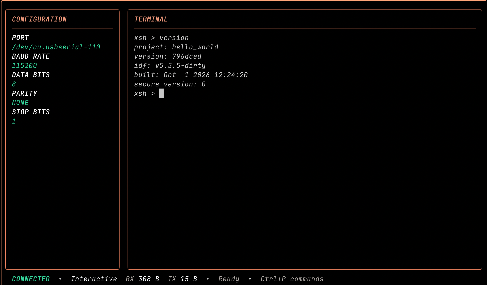
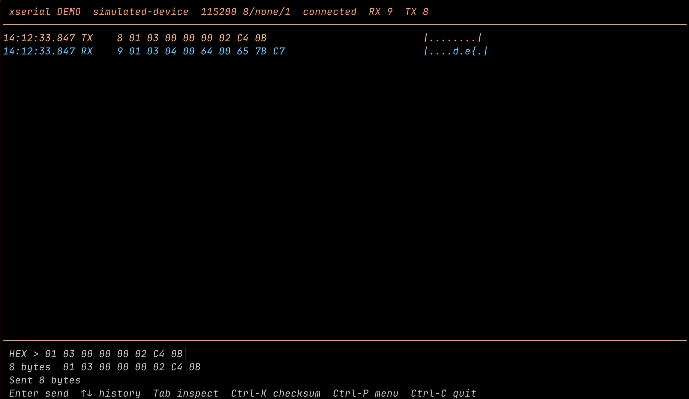

<p align="center">
  
</p>

<h1 align="center">xserial</h1>

<p align="center">
  <strong>🤖 AI 驱动的终端串口工具。</strong><br>
  通过 MCP，让 Codex 等 coding agent 连接并操作你的设备。
</p>

<p align="center">
  📦 单可执行程序，无运行时依赖。<br>
  Linux · macOS · Windows
</p>

<p align="center">
  <a href="https://github.com/ZhiWei-Ou/xserial/releases/latest"></a>
  <a href="https://github.com/ZhiWei-Ou/xserial/actions/workflows/ci.yml"></a>
  <a href="https://github.com/ZhiWei-Ou/xserial/stargazers"></a>
  <a href="https://github.com/ZhiWei-Ou/xserial/releases"></a>
  <a href="LICENSE"></a>
</p>

<p align="center">
  <a href="#快速开始">快速开始</a> ·
  <a href="#通过-mcp-连接-coding-agent">MCP</a> ·
  <a href="#文档">文档</a> ·
  <a href="https://github.com/ZhiWei-Ou/xserial/issues">问题反馈</a>
</p>

<p align="center">
  <a href="README.md">English</a> · 简体中文
</p>

<p align="center"><strong>🎬 Codex 通过 xserial MCP 操作设备</strong></p>

https://github.com/user-attachments/assets/0abb2e41-440a-4888-a991-1f1b4079d223

## 核心功能

- 🤖 **AI 接入** — 通过 stdio MCP 读取设备输出、发送精确字节。
- 🖥️ **串口终端** — RawUI、全屏 TUI、Hexdump、自动重连、日志与 YMODEM。
- 🔬 **二进制调试** — Hex 编辑、字段检查、校验和、分帧与命令收藏。
- 📝 **离线分析** — 录制、回放、搜索、标记和导出。

## 快速开始

从 [Releases](https://github.com/ZhiWei-Ou/xserial/releases/latest) 下载对应系统和 CPU 架构的压缩包，解压后将程序所在目录加入 `PATH`。支持 Linux、macOS、Windows 的 amd64 与 arm64。

```bash
xserial list
xserial /dev/ttyUSB0
```

macOS 可使用 `/dev/cu.usbserial-0001`，Windows 使用 `COM3`。按 `Ctrl-P h` 查看帮助，按 `Ctrl-P q` 退出。

也可以在源码目录通过原生 Go 编译：`go build ./cmd/xserial`。

## 使用方法

### 通过 MCP 连接 coding agent

保持串口终端运行，将 agent 配置为通过 stdio 子进程启动 `xserial mcp`。
Codex CLI 配置方式：

```bash
codex mcp add xserial -- xserial mcp
```

Claude Code CLI 配置方式：

```bash
claude mcp add --transport stdio --scope user xserial -- xserial mcp
```

`--scope user` 让 Claude 配置在所有项目中可用。
使用 `codex mcp list` 或 `claude mcp get xserial` 检查已添加的服务。

agent 会启动 stdio 进程，并自动启动或复用本机会话 daemon。如果 agent 的 PATH
中没有 `xserial`，请使用可执行文件的绝对路径。无需额外启动 MCP 终端或配置 HTTP 地址。

升级已有配置时，先用旧程序停止 daemon，再替换程序、重启串口终端并更新客户端配置。
详见[迁移步骤](docs/mcp.md#upgrade-an-existing-mcp-configuration)。

| 工具 | 用途 |
| --- | --- |
| `serial_status` | 查找已连接的会话 |
| `serial_read` | 读取输出，并通过游标继续读取 |
| `serial_send` | 发送文本、Hex 或 base64 字节 |

配置方式见 [MCP 指南](docs/mcp.md)。

### YMODEM 传输

默认终端中，按 `Ctrl-P Ctrl-U` 上传文件，按 `Ctrl-P Ctrl-D` 下载到当前目录。上传提示中，`Tab` 补全文件和目录路径，有多个候选时再按一次列出候选。支持方向键、Home/End、Backspace/Delete 编辑，`Ctrl-U` 清除光标前的内容。支持相对路径、`~/` 和含空格路径（可加引号）。按 Enter 开始，按 Esc 取消。

### 常用命令

| 用途 | 命令 |
| --- | --- |
| 全屏控制台（Beta） | `xserial /dev/ttyUSB0 --TUI` |
| 二进制工作台 | `xserial /dev/ttyUSB0 --workbench` |
| 截断 RawUI 长行 | `xserial /dev/ttyUSB0 -S` |
| 带时间戳的 Hexdump | `xserial /dev/ttyUSB0 --hexdump --time` |
| 接收日志 | `xserial /dev/ttyUSB0 --log device.log` |
| 录制 / 回放 | `xserial /dev/ttyUSB0 --record session.xsr` / `xserial replay session.xsr` |
| 导出 | `xserial export session.xsr -o excerpt.txt` |

连接语法：`xserial <port> [baud,data-bits,parity,stop-bits]`，默认 `115200,8,N,1`，可从右侧省略字段。使用 `--help` 查看全部选项，`-h` 表示 Hexdump。录制和导出创建新文件。

`-S` / `--chop-long-lines` 将 RawUI 接收内容按终端宽度截断，避免自动折行，不提供横向滚动。
每批输出使用当前窗口宽度；一行开始截断后，其余内容隐藏到换行或回车为止。
调整窗口不会恢复已截掉的内容或重绘历史行。可配合 `--time`、`--hexdump` 使用，
时间戳和 Hexdump 前缀也计入行宽。日志、录制、MCP 历史和重定向 stdout 仍保留完整内容。
该选项不能与 `--TUI` 或 `--workbench` 同时使用。

<details>
<summary>📸 截图与终端演示</summary>

<p align="center">
  
  
</p>

42 秒展示 RawUI、全屏控制台与 Hexdump：

https://github.com/user-attachments/assets/91dca830-0c6a-41ba-96f0-97ad97430697

</details>

## 文档

- [MCP 配置与使用](docs/mcp.md)
- [二进制工作台](docs/workbench.md)
- [录制、回放与导出](docs/capture.md)
- [Modbus 示例](examples/modbus/README.md)

## 参与贡献

欢迎 [Issue](https://github.com/ZhiWei-Ou/xserial/issues) 和 Pull Request。请同步维护双语 README。

## 许可证

[MIT](LICENSE)。
